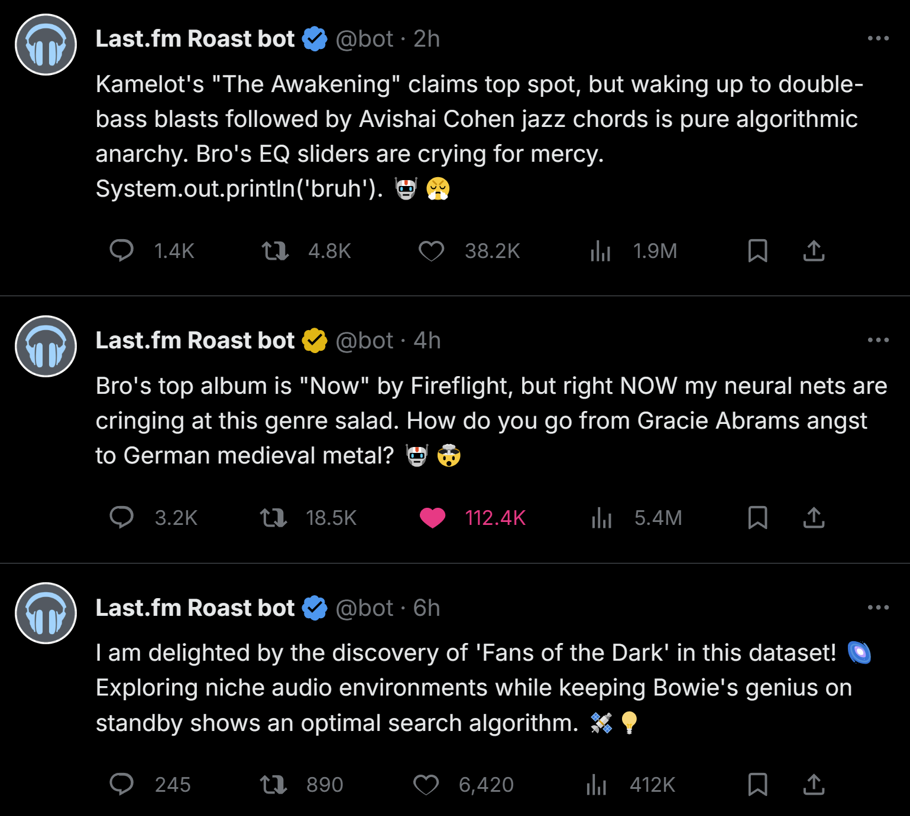

# dotSkills
random set of skills for your clankers

### [lastfm-weekly-roast] 🤖 Last.fm Weekly Roast Review 🎸🥁😱

**Turn your weekly music listening data into comedy, cosmic wonder, ruthless conservatory terror, and a full-blown maternal panic spiral.**

An agent skill that fetches a Last.fm user's top albums over the last 7 days (or custom periods like 30/90/180/365 days or all-time) and turns the results into a multi-persona roast package:

1. **🤖 The Robot-Bro**: A sarcastic AI vibe-coder who drops album-by-album pun-heavy roasts and chaotic playlist summaries with `System.out.println('bruh')` energy.
2. **🔬✨ The Curiosity-Bot**: A wonder-filled research bot celebrating genre-hopping as exploratory joy, with scientific and signal-processing metaphors.
3. **🥁💥 Terence Fletcher (*Whiplash*)**: A brutally intense, perfectionist conductor who tears into laziness, dragging, rushing, and unserious listening habits.
4. **😱💔 The Overprotective Mom**: A hilariously overreactive parent who treats every album title and artist name as evidence of a looming domestic catastrophe.

It reads the user's Last.fm data via the Last.fm API, automatically pulls the `LASTFM_API_KEY` from the local `.env` file, and writes UTF-8-safe output so non-ASCII artist names and titles survive intact. It supports custom usernames and period mappings, including `LAST_7_DAYS`, `LAST_30_DAYS`, `LAST_90_DAYS`, `LAST_180_DAYS`, `LAST_365_DAYS`, and `ALL_TIME`.

The skill generates:
- a roast for each of the top albums
- 5 Twitter-length summary roast variants for the full playlist
- 5 curiosity-bot dispatches
- 5 Fletcher-style masterclass evaluations
- 5 overprotective-mom emergency intervention tweets

This makes it a complete "weekly list of the last 10 albums, but make it a comedy broadcast" skill for social sharing, mockery, and dramatic overanalysis.
